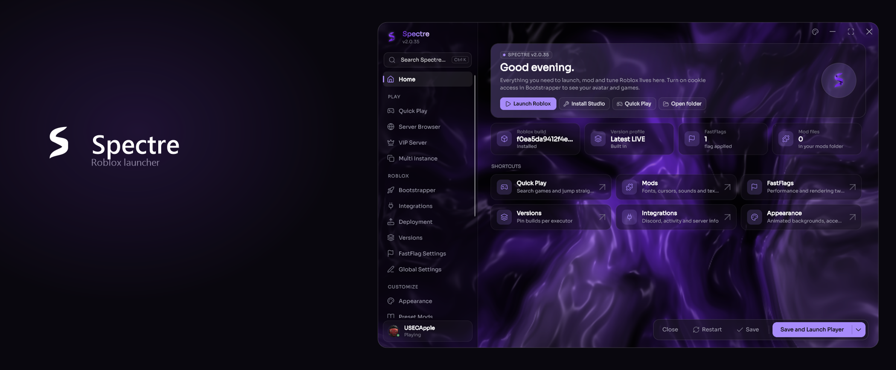
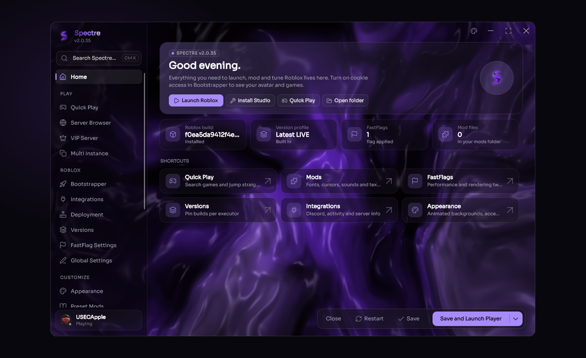

<p align="center">
  
</p>

<p align="center">
  <a href="https://github.com/lec1e/Spectre/releases/latest">
    
  </a>
  <a href="https://github.com/lec1e/Spectre/releases/latest">
    
  </a>
</p>

<p align="center">
  <strong>Spectre</strong> is a Roblox launcher with a dark glass window —
  Versions, mods, fast flags, and multi-instance.
</p>

<p align="center">
  
</p>

## What’s new in 2.0.40

- Launching Roblox no longer deletes the Roblox login cookie in your browser

## What’s new in 2.0.39

- The tray menu fills in as soon as a game starts: invite, server, rejoin, and region
- Discord presence shows the game while you are playing, with the current Spectre logo
- The auto updater no longer skips a release because the tray watcher is open

## What’s new in 2.0.38

- Launching Roblox clears the local Roblox data and the saved login, so the client opens signed out
- Roblox cookies in installed browsers are cleared as part of that launch

## What’s new in 2.0.37

- Launching Roblox again deletes the installed version and downloads a new copy
- That install also clears the package cache and Roblox’s cache

## What’s new in 2.0.36

- The tray stays up while Roblox from the Spectre folder is launching or playing
- Hovering the tray icon shows Roblox, or the game name once you are in a server

## What’s new in 2.0.35

- Search results and the home actions are smaller
- Open folder sits next to Launch
- The session card lists every account that is in a Roblox window

## What’s new in 2.0.34

- The ribbon logo follows the animated background
- Installing Roblox, or a Versions profile, deletes the current version folder and downloads a fresh copy
- Spectre notices an official Roblox install and refreshes on the next launch
- Discord presence can be toggled from the tray while Spectre is minimized
- Taskbar and tray icons are white
- Prompts, the installer, and join notifications use the animated background

## What’s new in 2.0.33

- Toasts sit above the tray, next to the clock, without covering the taskbar
- Discord Rich Presence uses the Spectre application and shows while Roblox is open

## What’s new in 2.0.32

- Loader, server info, toasts, and other popups use the same glass + nebula chrome as the launch menu
- Starting Roblox window is smaller and rounded
- Notifications are Spectre toasts, not Windows notifications

## What’s new in 2.0.31

- Loader, uninstall, and server-info toast use the same nebula + Spectre mark as the launch menu
- Rejoin / server details show in the tray while you are in a game
- Server info pops up when you join
- Releases ship **Spectre.exe** only

## What’s new in 2.0.30

- Download is **Spectre.exe**
- Home greeting uses your computer name
- Animated crimson nebula background from the Spectre banner
- Tab previews for Home, Games, Library, Mods, and Settings

## Features

- **Versions Manager** — one profile per executor (WEAO / manual hash), optional picker on launch
- **LIVE channel lock** — Player launches forced to production (toggleable)
- **Liquid glass UI** — dark crimson shell, cursor ribbon, 30+ color presets
- **BanAsync** (Windows) — clean Roblox traces, MAC / MachineGuid helpers
- **Multi-instance + window tiling**
- **VIP / Server Browser / News**
- **Privacy mode** — truncate `RobloxCookies.dat` before launch
- **Stream mode** — hide account-identifying UI while streaming

## Download

Grab the latest **Spectre.exe** from [Releases](https://github.com/lec1e/Spectre/releases/latest).

Auto-update picks up new stable releases when update checks are enabled.

## Build

```bash
dotnet build Froststrap/Froststrap.csproj -c Release
```

## License

AGPL-3.0 for Spectre modifications; MIT for upstream Bloxstrap / Fishstrap / Froststrap code.
