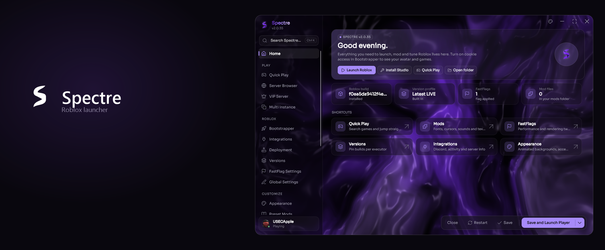
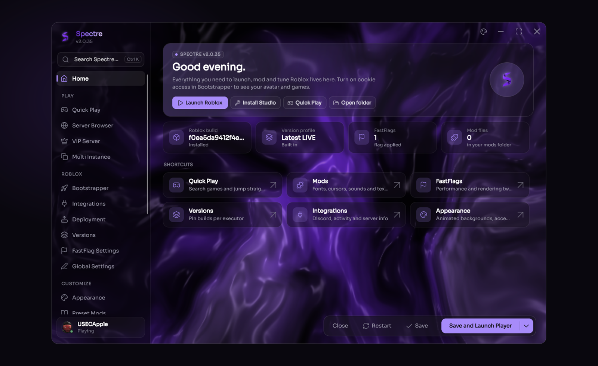

<p align="center">
  
</p>

<p align="center">
  <a href="https://github.com/lec1e/Spectre/releases/latest">
    
  </a>
  <a href="https://github.com/lec1e/Spectre/releases/latest">
    
  </a>
</p>

<p align="center">
  <strong>Spectre</strong> is a Roblox launcher with a dark glass window —
  Versions, mods, fast flags, and multi-instance.
</p>

<p align="center">
  
</p>

## Features

- **Versions Manager** — one profile per executor (WEAO / manual hash), optional picker on launch
- **LIVE channel lock** — Player launches forced to production (toggleable)
- **Liquid glass UI** — dark crimson shell, cursor ribbon, 30+ color presets
- **BanAsync** (Windows) — clean Roblox traces, MAC / MachineGuid helpers
- **Multi-instance + window tiling**
- **VIP / Server Browser / News**
- **Privacy mode** — truncate `RobloxCookies.dat` before launch
- **Stream mode** — hide account-identifying UI while streaming

## Download

Grab the latest **Spectre.exe** from [Releases](https://github.com/lec1e/Spectre/releases/latest).

Auto-update picks up new stable releases when update checks are enabled.

## Build

```bash
dotnet build Froststrap/Froststrap.csproj -c Release
```

## License

AGPL-3.0 for Spectre modifications; MIT for upstream Bloxstrap / Fishstrap / Froststrap code.
